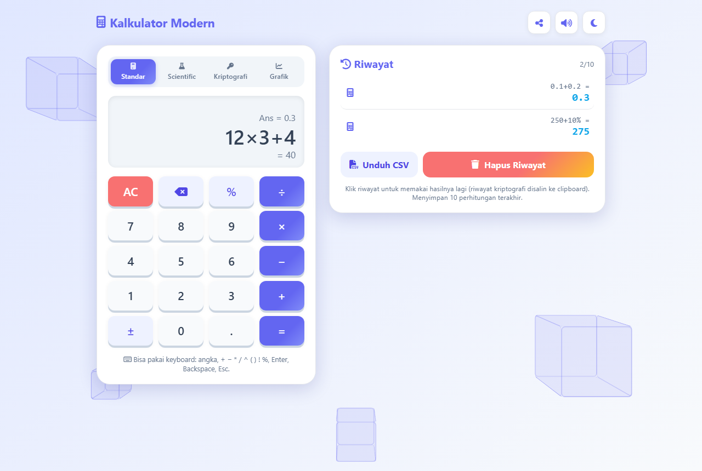
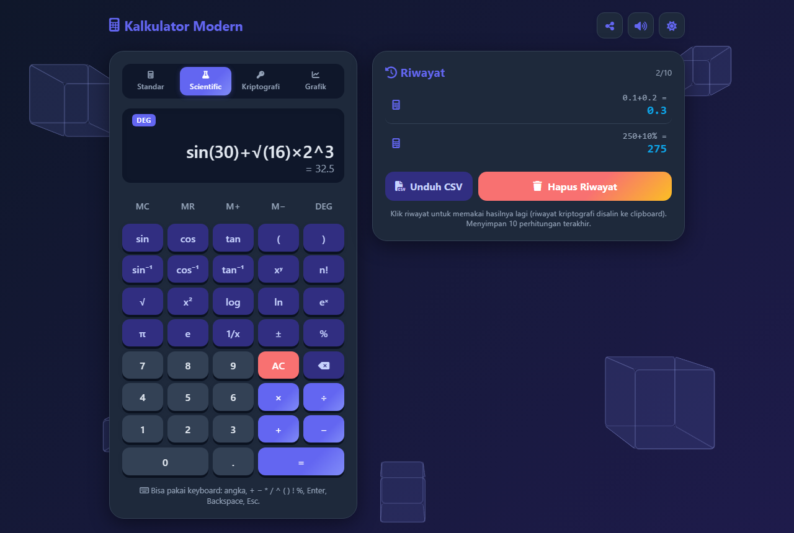
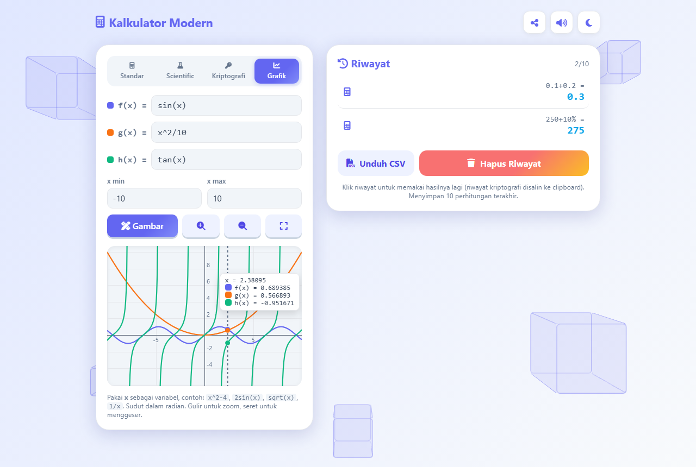
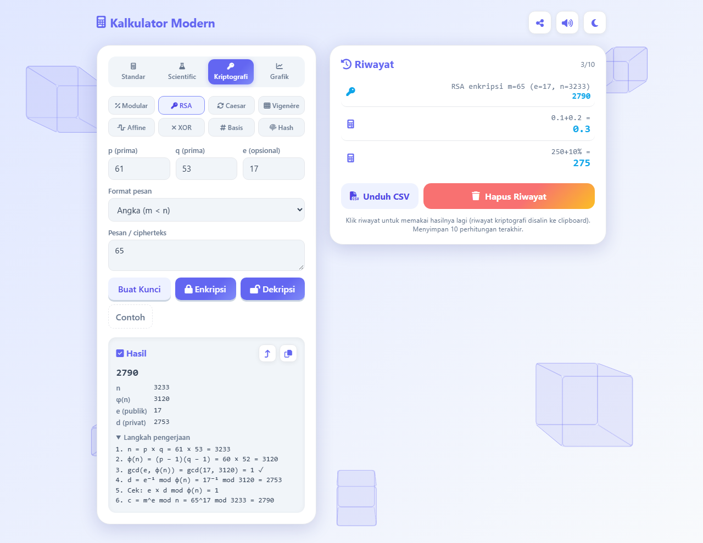
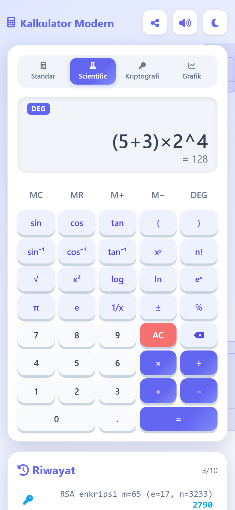

# 🧮 Modern Scientific Calculator

[](https://laravel.com)
[](https://php.net)
[](https://developer.mozilla.org/en-US/docs/Web/JavaScript)
[](LICENSE)

> **Kalkulator web modern berbasis Laravel dengan 4 mode — Standar, Scientific, Grafik fungsi, dan Kriptografi (lengkap dengan langkah pengerjaan) — plus pratinjau hasil langsung, link berbagi, ekspor riwayat CSV, animasi 3D, tema gelap/terang, dukungan keyboard, dan tampilan responsif.**

## 📸 Tampilan

| Standar (pratinjau hasil + riwayat) | Scientific (tema gelap) |
|:---:|:---:|
|  |  |
| **Grafik fungsi** | **Kriptografi RSA dengan langkah pengerjaan** |
|  |  |

<p align="center">
  <br>
  <em>Tampilan di HP</em>
</p>

## 📋 Daftar Isi

- [📸 Tampilan](#-tampilan)
- [✨ Fitur](#-fitur)
- [🚀 Instalasi](#-instalasi)
- [💻 Penggunaan](#-penggunaan)
- [🏗️ Struktur Proyek](#️-struktur-proyek)
- [🔌 Endpoint](#-endpoint)
- [🧪 Testing](#-testing)
- [📄 License](#-license)

## ✨ Fitur

### 🧮 Mode Standar & Scientific
- **Standar**: `+ − × ÷`, persen, ±, backspace.
- **Scientific**: `sin cos tan`, `sin⁻¹ cos⁻¹ tan⁻¹`, `log ln`, `eˣ`, `√`, `x²`, `xʸ`, `n!`, `1/x`, kurung `( )`, konstanta `π` dan `e`.
- Mode sudut **DEG / RAD**.
- Memori **MC, MR, M+, M−** dengan indikator `M`.
- Pindah mode dengan animasi flip; mode terakhir diingat browser.

### 📈 Grafik Fungsi
- Gambar hingga 3 fungsi sekaligus, mis. `sin(x)`, `x^2/10`, `1/x`.
- Tooltip nilai saat kursor di atas grafik, zoom dengan scroll / tombol, geser dengan drag.
- Sumbu y otomatis, garis tidak tersambung palsu di asimtot (tan, 1/x).

### ⚡ Fitur Praktis
- **Pratinjau langsung**: hasil muncul saat mengetik, sebelum menekan `=`.
- **Link berbagi**: tombol 🔗 menyalin link yang membuka perhitungan/grafik yang sama.
- **Unduh riwayat CSV** (aman dari CSV injection, terbaca rapi di Excel).

### 🔐 Kalkulator Kriptografi
Mode ketiga dengan langkah pengerjaan untuk setiap hasil:
- **Aritmetika modular**: `a mod n`, pangkat modular `aᵇ mod n` (square-and-multiply), invers modular, GCD + Euclid diperluas (identitas Bézout), cek bilangan prima (Miller-Rabin) + faktorisasi, fungsi Euler `φ(n)`. Mendukung angka besar (hingga 400 digit).
- **RSA**: buat kunci dari `p`, `q`, `e` (atau `e` otomatis), enkripsi/dekripsi angka atau teks.
- **Cipher klasik**: Caesar (termasuk brute force), Vigenère, Affine, XOR.
- **Konversi basis** 2–36 (biner, oktal, heksa, …) dengan langkah pembagian berulang.
- **Hash & encoding**: MD5, SHA-1, SHA-256, SHA-512, SHA3-256, CRC32, Base64, Hex.
- Tombol salin hasil dan "pakai hasil sebagai input" untuk mencoba enkripsi → dekripsi.

### 🧠 Mesin Hitung di Server
- Ekspresi dihitung oleh **parser ekspresi milik sendiri** (recursive-descent) di Laravel — tidak memakai `eval()`, jadi aman dari injeksi kode.
- Prioritas operator yang benar (`2+3×4 = 14`), pangkat asosiatif kanan, perkalian implisit (`2π`, `3(4+1)`), kurung ditutup otomatis.
- Persen bergaya kalkulator: `200 + 10% = 220`.
- Hasil bebas galat floating point (`0.1 + 0.2 = 0.3`), angka sangat besar/kecil memakai notasi ilmiah (`1E+21`).
- Pesan error yang jelas: bagi nol, akar negatif, log ≤ 0, `tan(90°)`, faktorial bukan bilangan bulat, dll.

### 📊 Riwayat
- Menyimpan **10 perhitungan terakhir** dari semua mode (Standar, Scientific, Kriptografi) di session Laravel, ditandai ikon mode, dan tetap ada setelah halaman di-refresh.
- Klik riwayat angka untuk memakai hasilnya lagi; klik riwayat kriptografi untuk menyalin hasilnya.
- Unduh riwayat sebagai CSV, atau hapus riwayat dengan konfirmasi.

### 🎨 Desain
- **Animasi 3D**: kartu miring mengikuti kursor, flip saat ganti mode, hasil berputar seperti jam flip, kubus 3D di latar.
- Tema **gelap/terang** (mengikuti sistem, bisa diganti manual).
- Responsif untuk desktop, tablet, dan HP.
- Suara klik (Web Audio, tanpa file eksternal) yang bisa dimatikan.
- Menghormati pengaturan *reduce motion*.

## 🚀 Instalasi

### Kebutuhan

| Kebutuhan | Versi |
|-----------|-------|
| PHP | 8.2+ (ekstensi `bcmath`, `mbstring`, `openssl`, `fileinfo`) |
| Composer | 2.x |
| Browser | Chrome / Firefox / Safari / Edge modern |

Tidak perlu database dan tidak perlu Node.js/npm — CSS dan JS sudah siap di folder `public/`.

### Langkah

```bash
# 1. Clone repository
git clone https://github.com/whympxx/Kalkulator-Standar-Scientific.git
cd Kalkulator-Standar-Scientific

# 2. Install dependency PHP
composer install

# 3. Siapkan konfigurasi
cp .env.example .env        # Windows: copy .env.example .env
php artisan key:generate

# 4. Jalankan
php artisan serve
```

Buka **http://localhost:8000**.

> Memakai XAMPP/Laragon? Arahkan *document root* ke folder `public/`, bukan ke root proyek.

## 💻 Penggunaan

| Tombol / Keyboard | Fungsi |
|-------------------|--------|
| `0-9`, `.` | Input angka |
| `+` `-` `*` `/` | Operasi dasar |
| `^` | Pangkat |
| `(` `)` | Kurung |
| `!` `%` | Faktorial, persen |
| `Enter` / `=` | Hitung |
| `Backspace` | Hapus satu karakter/fungsi |
| `Esc` / `Delete` | Hapus semua (AC) |
| `p` / `e` | Konstanta π / e |

Setelah menekan `=`, menekan operator akan melanjutkan dari hasil (`Ans`), sedangkan menekan angka memulai perhitungan baru.

**Mode Grafik** — tulis fungsi memakai variabel `x` (mis. `x^2-4`, `2sin(x)`, `sqrt(x)`), atur `x min`/`x max`, lalu tekan **Gambar**. Arahkan kursor untuk melihat nilai, gulir untuk zoom, seret untuk menggeser. Sudut di mode grafik memakai radian.

**Mode Kriptografi** — pilih alat (Modular, RSA, Caesar, Vigenère, Affine, XOR, Basis, Hash), isi kolomnya (RSA punya tombol **Contoh**), lalu lihat hasil beserta *Langkah pengerjaan*. Tombol ⤴ memakai hasil sebagai input berikutnya (mis. enkripsi → dekripsi).

**Link berbagi** — tombol 🔗 di pojok kanan atas menyalin link yang langsung membuka mode, ekspresi, atau grafik yang sedang tampil.

## 🏗️ Struktur Proyek

```
app/
├── Http/Controllers/CalculatorController.php   # halaman, hitung, riwayat
├── Http/Controllers/CryptoController.php       # endpoint kriptografi
├── Http/Requests/CalculateRequest.php          # validasi input
└── Services/
    ├── Calculator/
    │   ├── Tokenizer.php            # memecah teks jadi token
    │   ├── ExpressionEvaluator.php  # parser & evaluator ekspresi
    │   ├── ResultFormatter.php      # merapikan hasil (0.3, 1e+21, ...)
    │   ├── HistoryRepository.php    # riwayat di session
    │   └── CalculationException.php
    └── Crypto/
        ├── BigMath.php              # bilangan besar (bcmath), Miller-Rabin, Euclid
        ├── ModularCalculator.php    # aritmetika modular + langkah
        ├── RsaCalculator.php        # kunci, enkripsi, dekripsi RSA
        ├── ClassicCipher.php        # Caesar, Vigenère, Affine
        ├── HashCalculator.php       # hash, Base64, Hex
        ├── XorCipher.php            # cipher XOR
        └── BaseConverter.php        # konversi basis 2–36
resources/views/calculator.blade.php            # tampilan
public/css/calculator.css                       # gaya + tema
public/js/calculator.js                         # logika tombol & keyboard
routes/web.php
tests/Unit/ExpressionEvaluatorTest.php
tests/Feature/CalculatorTest.php
docs/screenshots/                               # gambar tampilan untuk README
legacy/                                         # versi PHP lama (arsip)
```

## 🔌 Endpoint

| Method | URL | Keterangan |
|--------|-----|------------|
| `GET` | `/` | Halaman kalkulator |
| `POST` | `/calculate` | Body JSON `{ expression, mode: standard\|scientific, angle: deg\|rad }` → `{ expression, result, history }`, atau `422 { message }` bila error |
| `GET` | `/history` | Daftar riwayat |
| `DELETE` | `/history` | Hapus riwayat |
| `POST` | `/preview` | Seperti `/calculate` tapi tidak disimpan ke riwayat |
| `POST` | `/plot` | `{ functions: [..maks 3], from, to, samples? }` → `{ x[], series[{ expression, y[] \| error }] }` |
| `GET` | `/history/export` | Unduh riwayat (CSV) |
| `POST` | `/crypto/base` | `{ value, from_base, to_base }` |
| `POST` | `/crypto/xor` | `{ action: encrypt\|decrypt, text, key }` |
| `POST` | `/crypto/modular` | `{ operation: mod\|powmod\|inverse\|gcd\|prime\|totient, a, b?, n? }` |
| `POST` | `/crypto/rsa` | `{ action: keys\|encrypt\|decrypt, p, q, e?, message?, format: number\|text }` |
| `POST` | `/crypto/cipher` | `{ cipher: caesar\|vigenere\|affine, action: encrypt\|decrypt\|bruteforce, text, shift?, key?, a?, b? }` |
| `POST` | `/crypto/hash` | `{ action: hash\|base64_encode\|base64_decode\|hex_encode\|hex_decode, text }` |

Endpoint kriptografi mengembalikan `{ summary, result, details[], steps[], history }`.

Semua endpoint memakai proteksi CSRF Laravel dan dibatasi 120 request/menit.

## 🧪 Testing

```bash
php artisan test
```

Mencakup 130+ test: mesin hitung (prioritas operator, trigonometri, persen, error domain, input berbahaya), kriptografi (dicocokkan dengan contoh buku teks, mis. RSA p=61, q=53, e=17 → d=2753; Vigenère "ATTACK AT DAWN" + LEMON → "LXFOPV EF RNHR"), dan endpoint (validasi, riwayat, escaping XSS).

## 📄 License

Proyek ini berlisensi **MIT** — lihat file [LICENSE](LICENSE).

---

<div align="center">

**Built with ❤️ by [whympxx](https://github.com/whympxx)**

</div>
